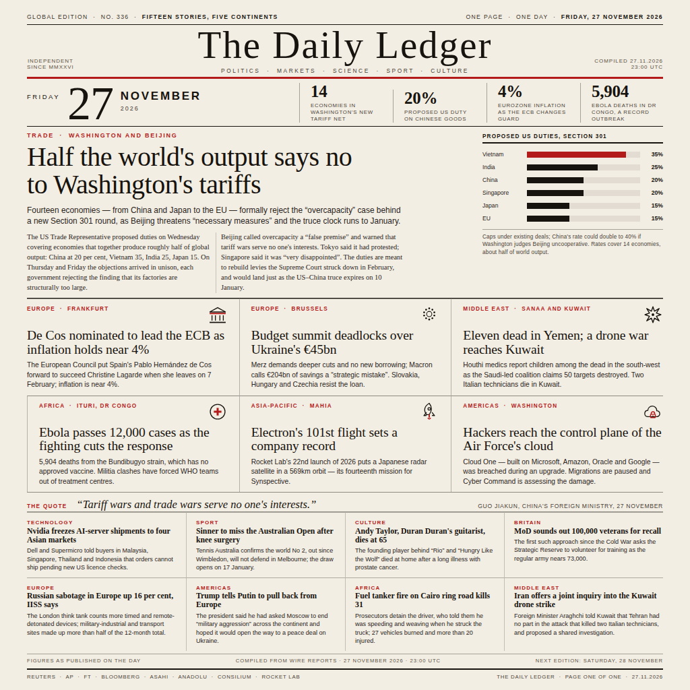

# The Daily Ledger — 27 November 2026

A one-page newspaper front page that sums up the world news of **Friday, 27 November 2026**
in a single 1024×1024 image.

Built for the make.fun bounty [`news-image-20261127`](https://make.fun/bounty/news-image-20261127)
— "Sum up 27 November's world news in one image".



## Design

Financial Times / The Economist front-page language, hand-written in one file of inline HTML,
CSS and SVG — no images, no webfonts, no framework, no network at render time.

- Newsprint `#f3eee3`, ink `#17130e`, a single accent red `#b31b1b`
- Serif headlines (Liberation Serif / Georgia), sans deks (Liberation Sans / Helvetica)
- Masthead rule, oversized dateline, four figures of the day, a lead story with a chart,
  a 2×3 grid of pictogram stories, a pull quote and eight one-line briefs

## Stories

**Lead — Trade / Washington and Beijing**

Half the world's output says no to Washington's tariffs — fourteen economies formally reject
the Section 301 "overcapacity" finding; China threatens "necessary measures" as the truce
clock runs to 10 January.

1. **Europe · Frankfurt** — De Cos nominated to lead the ECB as inflation holds near 4%
2. **Europe · Brussels** — Budget summit deadlocks over Ukraine's €45bn
3. **Middle East · Sanaa and Kuwait** — Eleven dead in Yemen; a drone war reaches Kuwait
4. **Africa · Ituri, DR Congo** — Ebola passes 12,000 cases as the fighting cuts the response
5. **Asia-Pacific · Mahia** — Electron's 101st flight sets a company record
6. **Americas · Washington** — Hackers reach the control plane of the Air Force's cloud

**Briefs** — Nvidia freezes AI-server shipments to four Asian markets · Sinner to miss the
Australian Open after knee surgery · Andy Taylor, Duran Duran's guitarist, dies at 65 ·
MoD sounds out 100,000 veterans for recall · Brussels floats a digital levy and Washington
objects · Saudi and Turkish teams open talks in Islamabad · Fuel tanker fire on Cairo ring
road kills 31 · Iran offers a joint inquiry into the Kuwait drone strike

Five continents, nine domains (trade, economy, conflict, health, science, cyber, defence,
sport, culture). Sources and one-line facts are in [`RESEARCH.md`](RESEARCH.md).

## Run

```bash
python3 main.py
```

Deterministic: verifies `entry.png` is a 1024×1024 PNG of at most 1 MiB, then copies it to
`/output/entry.png`. No dependencies beyond the Python standard library. Outside the grader,
`MAKEFUN_OUTPUT_DIR` stands in for `/output`:

```bash
mkdir -p out && MAKEFUN_OUTPUT_DIR=out python3 main.py
```

## Licence

MIT — see [`LICENSE`](LICENSE).
